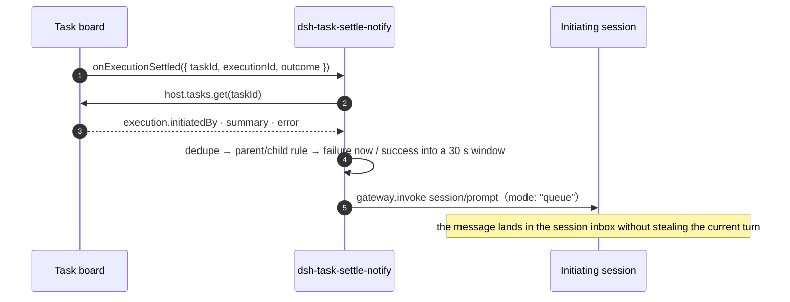

# dsh-task-settle-notify

> When a task-board card settles, **the session that started it gets a message**. No more polling the board.

[中文](./README.md) · [Architecture](./docs/ARCHITECTURE.md) · [Contract](./docs/CONTRACT.md) · [Install](./docs/INSTALL.md) · [Verification](./docs/VERIFICATION.md)

[](./LICENSE)
[](./test)
[](./package.json)
[](./package.json)
[](https://github.com/topics/dsh-plugin)


The screenshot is a real delivery: the card finished in its own execution session, and **the initiating session** immediately received the settlement notice.

## The gap it closes

`task_board_run` does not run a card in the current session — it opens a fresh **execution session**. When the card settles (`running → done | failed`), the session that started it hears nothing: it either polls the board by hand or simply forgets the card.

Desktop reminders (an Atoll indicator, say) are useful, but a reminder is not context: back in the session you still have to reconstruct which card it was, whether it passed, and where the artifact landed.

This plugin covers exactly that gap:

- on settlement, look up `execution.initiatedBy` and **deliver the result back into that session** as an ordinary user message;
- the message carries title, outcome, duration and one actionable next step; failures also carry the reason;
- delivery uses `mode: "queue"` — a busy session queues the message instead of being **interrupted**.

## What a message looks like

Single card (success):

```text
〔看板〕M2-B 已结算 · 成功 · 用时 9 分（会话 session-9f3c…）
产物在 src-tauri/src/kp_document.rs
```

Single card (failure — never batched, sent immediately):

```text
〔看板〕构建 Linux 包 已结算 · 失败 · 用时 2 分（会话 session-9f3c…）
原因：cargo build failed: linking with `cc` failed
下一步：查看 ~/.dsh/dsh-task-settle-notify/trace.log，或重跑该卡
```

Several successes inside the 30 s window:

```text
〔看板〕3 张卡已结算 · 成功 · 用时合计 21 分（会话 session-9f3c…）
· 修 K 线导出 · 8 分 · 产物在 src/kline.rs
· 补任务看板文档 · 6 分 · 下一步：打开看板查看该卡详情
· 升级依赖 · 7 分 · 产物在 package.json
```

Parent card settling (children do not flood the session):

```text
〔看板〕里程碑 M2 已结算 · 成功 · 用时 1 小时 12 分（会话 session-9f3c…）
下一步：打开看板查看该卡详情
含 4 个子任务：导出、导入、去重、文档
```

Message text is currently **Chinese only** (the samples above are verbatim output); the settings card itself is bilingual. See [Limitations](#known-limitations).

## Features

| Capability | Behaviour |
| --- | --- |
| **Settle-time delivery** | Subscribes to `onExecutionSettled`, routes by `initiatedBy` — no polling |
| **30 s batching** | Successes from one initiator inside the window merge into one message; each initiator gets its own |
| **Failures first** | Failed cards skip the window and go out immediately, with reason and next step |
| **Parent/child folding** | Children stay quiet while the parent runs; the parent message summarises them. Orphans (parent already settled) still notify |
| **Execution dedupe** | Each `executionId` is handled once; duplicate events cannot double-notify |
| **Side-car** | No DSH patch, no board patch, no ledger writes; only the board's public provider extension and `session/prompt` |
| **Configurable** | Four settings plus a browser card that also reports live status (pending / delivered / failed / folded) |
| **Self-healing** | Callback errors never escape; one retry after registration failure (5 s) and after delivery failure (1.5 s); capped logs |

## Install

Requires Node ≥ 20, `dsh` on `PATH`, and a profile that has been launched at least once (default `web`).

```bash
git clone https://github.com/chenvinc/dsh-task-settle-notify.git
cd dsh-task-settle-notify
node scripts/install.mjs
```

The script does four things: snapshots every profile file it will touch into `<repo>/.backup/<timestamp>/`; runs `dsh plugin add link:<repo>` in the profile (pnpm link, nothing is published to npm); appends `dsh-task-settle-notify` to `dsh.profile.bundles`; writes an install receipt. It does **not** touch the DSH source, the board package or the ledger.

When the profile sets `dsh.profile.patchReload: live`, the host hot-loads the bundle — usually no restart. Verify:

```bash
curl -s http://127.0.0.1:3080/api/task-settle-notify/status
# {"ok":true,"status":{"extensionActive":true,"pending":0,"delivered":1,...}}
```

`extensionActive: true` means the plugin is wired to the board; a persistent 404 means restart `dsh web`.

Uninstall (surgical — files changed by someone else after install are left alone):

```bash
node scripts/uninstall.mjs
```

Details and troubleshooting: [docs/INSTALL.md](./docs/INSTALL.md).

## Settings

UI: **Settings → Task settlement notifications**; changes apply live, no restart.

| Setting | Default | Notes |
| --- | --- | --- |
| Enable settlement notices | on | master switch; the board keeps running when off |
| Batching window (s) | 30 | clamped to 5..600 |
| Only session-started cards | off | cron runs have no initiating session and are always skipped |
| Summarize subtasks | on | children are never sent separately |

The same values can live under `config` in `cordis.patch.yml`, or be overridden by `~/.dsh/profiles/web/task-settle-notify/settings.json` (atomic write, convenient for scripts and dotfiles).

HTTP routes (same-origin, JSON):

```text
GET  /api/task-settle-notify/settings   read settings
POST /api/task-settle-notify/settings   patch settings (application/json)
GET  /api/task-settle-notify/status     diagnostics: extensionActive / pending / delivered / failed / suppressed / lastDelivery
```

## How it works



The broadcast carries only `{ taskId, executionId, outcome }` — **no session id** — so the plugin looks the task up through `host.tasks.get(taskId)`, finds this execution in `task.executions[]` by `executionId`, and reads `initiatedBy` as the recipient.

**Why not poll the ledger**: `~/.dsh/task-board/ledger-v2.json` has a single-writer lock and is rewritten wholesale on `commit()`. A third-party reader cannot join the lock protocol, `fs.watch` only sees rename noise, and `revision` tells you *that* something changed, not what. The board's own `onExecutionSettled` is the only transactional, zero-intrusion entry point.

Files, line numbers and the exact contract: [docs/ARCHITECTURE.md](./docs/ARCHITECTURE.md), [docs/CONTRACT.md](./docs/CONTRACT.md).

## Compatibility

| Item | Requirement | Verified here |
| --- | --- | --- |
| DSH | ≥ `0.2.1-rc.2` | `0.2.1-rc.2` |
| Task board | provider extension v1, `@linxin666/dsh-client-ui-task-board` ≥ 0.4.8 | 0.4.8 |
| Node | ≥ 20 | 24.19.0 |
| Profile | any (installer defaults to `web`) | `web` |
| Platform | pure Node, no native deps; only tested on macOS | macOS |

On a board without provider extension support the plugin stays idle and silent — it never quietly degrades into polling.

## Known limitations

| Limitation | Detail |
| --- | --- |
| Same Host and profile only | Cross-Host, remote or deleted sessions fail into `error.log` |
| No cron / external outcomes | They have no initiating session (`record-external-outcome`'s `initiatedBy` is a label, not a session) |
| Delivered ≠ read | The host only accepts and queues; a permanently busy session keeps the message queued |
| No replay | Settlements from before a plugin restart are not sent |
| Subagent sessions cannot receive | The gateway rejects them (`owned by subagent routing`); logged as a failure, never redirected to the parent |
| Message text is Chinese only | The settings card is bilingual; the message copy is not localised yet |
| 4000-character cap | Extremely large batches get truncated, and the hint shortens with them |

## Development

```bash
npm test        # node --test, 45 tests, no external services
```

```
index.js          entry: config, wait for taskBoard, build the watcher, mount HTTP
client.js         browser settings card (settings.section)
lib/parse.js      event → task/execution → settlement record; execution dedupe
lib/aggregate.js  parent/child rule, runGroup child summary
lib/batcher.js    fixed 30 s window; failures bypass it
lib/format.js     copy, "artifact at …" and "next step" hints
lib/delivery.js   session/prompt + owner peer
lib/watcher.js    provider extension registration and orchestration
lib/http.js       settings / status routes
lib/settings-store.js  user settings JSON (atomic)
lib/log.js        error.log / trace.log with size caps
test/             node:test + hand-written ledger fixtures
scripts/          install.mjs / uninstall.mjs
docs/             architecture, contract, install, verification
```

## Verification

Beyond unit tests, the plugin has been exercised end to end against a **real host and a real board**: settlement-to-delivery interval **30.012 s** (exactly the batching window), the delivered message present in the initiating session's durable log (`agent/inbox/spliced`, `seq: 1472`), and `status` reporting `delivered: 1, failed: 0`. Full record — ids, timestamps, log excerpts — in [docs/VERIFICATION.md](./docs/VERIFICATION.md).

## License

[MIT](./LICENSE) © chenvinc

Community plugin, not an official DeepSeek project; names such as "DeepSeek Harness" belong to their respective owners.
