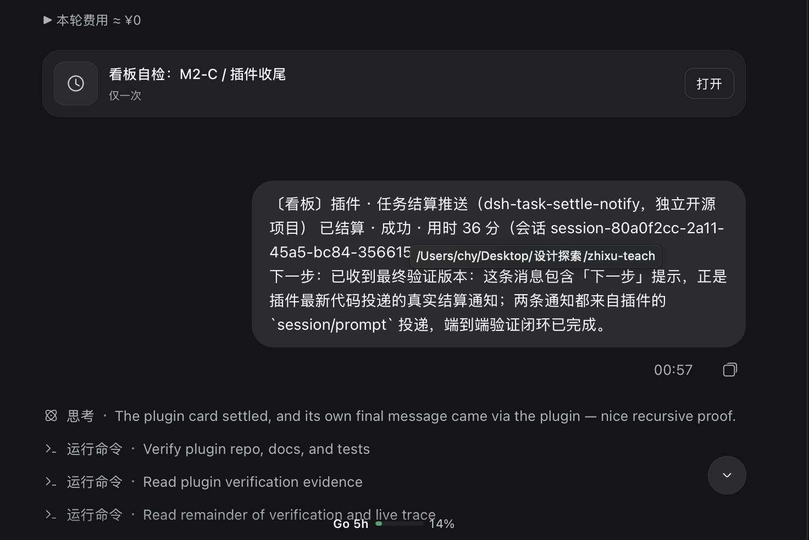
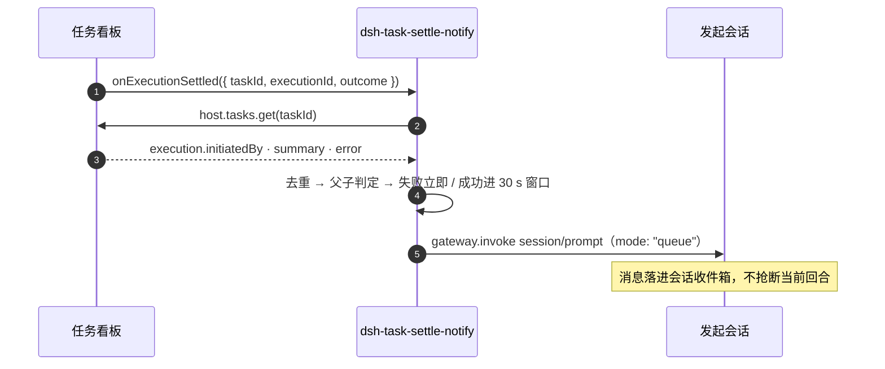

# dsh-task-settle-notify

> 任务看板上的卡片结算了，**发起它的那个会话会收到一条消息**。不用再手刷看板。

[English](./README.en.md) · [架构](./docs/ARCHITECTURE.md) · [契约](./docs/CONTRACT.md) · [安装](./docs/INSTALL.md) · [验证](./docs/VERIFICATION.md)

[](./LICENSE)
[](./test)
[](./package.json)
[](./package.json)
[](https://github.com/topics/dsh-plugin)



上图是真实投递结果：卡片在自己的执行会话里跑完，**发起会话**随即收到一条看板结算消息。

## 它解决什么问题

`task_board_run` 不是把卡片跑在当前会话里，而是新开一个**执行会话**。卡片结算（`running → done | failed`）时，发起它的会话收不到任何东西——只能自己反复看板，或者干脆忘了这张卡。

让看板在你自己身上弹提醒（比如灵动岛灯）是好用的，但**提醒不等于上下文**：切回会话后，你得自己回忆哪张卡、跑成功没有、产物在哪。

本插件补上这一段，并且只做这一段：

- 结算瞬间，按 `execution.initiatedBy` 把结果**送回发起会话**，作为一条普通用户消息；
- 消息带标题、成败、耗时和一句“下一步”，失败卡还带原因；
- 投递用 `mode: "queue"`——会话正忙就排队，**不打断**它手上的回合。

## 一条消息长什么样

单卡（成功）：

```text
〔看板〕M2-B 已结算 · 成功 · 用时 9 分（会话 session-9f3c…）
产物在 src-tauri/src/kp_document.rs
```

单卡（失败，永不参与合批，立即发）：

```text
〔看板〕构建 Linux 包 已结算 · 失败 · 用时 2 分（会话 session-9f3c…）
原因：cargo build failed: linking with `cc` failed
下一步：查看 ~/.dsh/dsh-task-settle-notify/trace.log，或重跑该卡
```

30 秒窗口内多张成功卡：

```text
〔看板〕3 张卡已结算 · 成功 · 用时合计 21 分（会话 session-9f3c…）
· 修 K 线导出 · 8 分 · 产物在 src/kline.rs
· 补任务看板文档 · 6 分 · 下一步：打开看板查看该卡详情
· 升级依赖 · 7 分 · 产物在 package.json
```

父卡结算（子任务不单独刷屏）：

```text
〔看板〕里程碑 M2 已结算 · 成功 · 用时 1 小时 12 分（会话 session-9f3c…）
下一步：打开看板查看该卡详情
含 4 个子任务：导出、导入、去重、文档
```

## 功能

| 能力 | 行为 |
| --- | --- |
| **结算即通知** | 订阅 `onExecutionSettled`，按 `initiatedBy` 回投，无需轮询 |
| **30 秒合批** | 窗口内同一发起会话的成功卡合并成一条；跨发起会话各收各的 |
| **失败优先** | 失败卡不进窗口，立刻单发，带原因和下一步 |
| **父子聚合** | 子卡在父卡 running 时静默，父卡结算时汇总一行；父卡已结束的孤儿卡照常通知 |
| **执行去重** | 同一 `executionId` 只处理一次，重复事件不会重复通知 |
| **旁路只读** | 不改 DSH、不改看板包、不写账本；只用公开的 provider extension 与 `session/prompt` |
| **可关可调** | 四个开关 + 浏览器设置卡，带运行状态（待合批 / 已投递 / 失败 / 已聚合） |
| **自愈** | 回调异常不外溢；注册失败 5 s 后重试一次；投递失败 1.5 s 后重试一次；日志有上限 |

## 安装

前提：Node ≥ 20、`dsh` 在 `PATH`、目标 profile 至少启动过一次（默认 `web`）。

```bash
git clone https://github.com/chenvinc/dsh-task-settle-notify.git
cd dsh-task-settle-notify
node scripts/install.mjs
```

脚本只做四件事：把将被改动的 profile 文件快照到 `<repo>/.backup/<时间戳>/`；在 profile 里执行 `dsh plugin add link:<repo>`（pnpm link，不走 npm 发布）；把 `dsh-task-settle-notify` 加进 `dsh.profile.bundles`；写一份安装回执。**不碰 DSH 源码、看板包和账本。**

profile 的 `dsh.profile.patchReload` 为 `live` 时宿主会热挂载，通常不用重启。验证：

```bash
curl -s http://127.0.0.1:3080/api/task-settle-notify/status
# {"ok":true,"status":{"extensionActive":true,"pending":0,"delivered":1,...}}
```

`extensionActive: true` 即接上看板；仍是 404 就重启 `dsh web`。

卸载（外科式，安装后被别人改过的文件一律保留）：

```bash
node scripts/uninstall.mjs
```

细节与排障见 [docs/INSTALL.md](./docs/INSTALL.md)。

## 配置

界面在 **设置 → 任务结算通知**，改完即生效（无需重启）：

| 项 | 默认 | 说明 |
| --- | --- | --- |
| 启用结算通知 | 开 | 总开关；关掉只看板照常跑 |
| 合批窗口（秒） | 30 | 5..600，超出自动夹紧 |
| 只看会话发起的卡 | 关 | cron 没有发起会话，本来就跳过 |
| 父卡汇总子任务 | 开 | 子任务不单独发消息 |

同样可以写在 `cordis.patch.yml` 的 `config` 里，或用 `~/.dsh/profiles/web/task-settle-notify/settings.json` 覆盖（原子写，适合脚本或 dotfiles 管理）。

HTTP 路由（同源、JSON）：

```text
GET  /api/task-settle-notify/settings   读取设置
POST /api/task-settle-notify/settings   增量写入（application/json）
GET  /api/task-settle-notify/status     诊断：extensionActive / pending / delivered / failed / suppressed / lastDelivery
```

## 工作原理



看板广播的结算事件只有 `{ taskId, executionId, outcome }`，**没有 session id**，所以插件回查 `host.tasks.get(taskId)`，在 `task.executions[]` 里按 `executionId` 找到本次执行，读 `initiatedBy` 作为收件人。

**为什么不是轮询账本**：`~/.dsh/task-board/ledger-v2.json` 有单写者锁、只在 `commit()` 时整体重写，第三方读文件既参与不了锁协议，fs.watch 也只会拿到 rename 噪声；revision 只能告诉你“变了”。看板自己的 `onExecutionSettled` 是唯一带事务语义、零侵入的入口。

详细契约与文件行号见 [docs/ARCHITECTURE.md](./docs/ARCHITECTURE.md)、[docs/CONTRACT.md](./docs/CONTRACT.md)。

## 兼容性

| 项 | 要求 | 本机验证 |
| --- | --- | --- |
| DSH | ≥ `0.2.1-rc.2` | `0.2.1-rc.2` |
| 任务看板 | 支持 provider extension v1，`@linxin666/dsh-client-ui-task-board` ≥ 0.4.8 | 0.4.8 |
| Node | ≥ 20 | 24.19.0 |
| profile | 任意（安装脚本默认 `web`） | `web` |
| 平台 | 纯 Node、无原生依赖；只在 macOS 上实测 | macOS |

看板不支持 provider extension（旧版）时插件保持空闲、不报错，也不会偷偷降级成轮询。

## 已知限制

| 限制 | 说明 |
| --- | --- |
| 只覆盖本 Host、本 profile | 跨 Host / 远程 / 已删除会话投递失败，写 `error.log` |
| cron 与外部结算不通知 | 没有发起会话；`record-external-outcome` 的 `initiatedBy` 不是会话 |
| 投递成功 ≠ 人已读 | 只保证宿主接受并排队；目标会话长期忙就一直排队 |
| 不补发历史 | 插件启动/重启前的结算不会补消息 |
| 子代理会话不能收件 | gateway 拒绝（`owned by subagent routing`），记失败，不改投父会话 |
| 消息正文目前只有中文 | 设置卡已中文/英文双语，消息文案还没做 i18n |
| 单条消息上限 4000 字符 | 极端合批下会截断，提示语随之变短 |

## 开发

```bash
npm test        # node --test，45 条，无外部依赖
```

```
index.js          插件入口：读配置、等 taskBoard 服务、建 watcher、挂 HTTP
client.js         浏览器设置卡（settings.section）
lib/parse.js      事件 → task/execution → 结算记录；执行 id 去重
lib/aggregate.js  父子判定、runGroup 子任务汇总
lib/batcher.js    固定 30 s 窗口；失败立即单发
lib/format.js     文案、“产物在 …”与“下一步：…”提示
lib/delivery.js   session/prompt + owner peer
lib/watcher.js    provider extension 注册与编排
lib/http.js       settings / status 路由
lib/settings-store.js  用户设置 JSON（原子写）
lib/log.js        error.log / trace.log（大小上限）
test/             node:test + 手写账本 fixture
scripts/          install.mjs / uninstall.mjs
docs/             架构、契约、安装、验证
```

## 验证

单元测试之外，本机已用**真实宿主 + 真实看板**跑通端到端：结算到投递间隔 **30.012 s**（即 30 秒窗口），投递消息在发起会话的持久日志里可查（`agent/inbox/spliced`，`seq: 1472`），`status` 显示 `delivered: 1, failed: 0`。完整记录、id、时间戳与日志片段见 [docs/VERIFICATION.md](./docs/VERIFICATION.md)。

## License

[MIT](./LICENSE) © chenvinc

社区插件，非 DeepSeek 官方项目；"DeepSeek Harness" 相关名称归其各自权利人所有。
